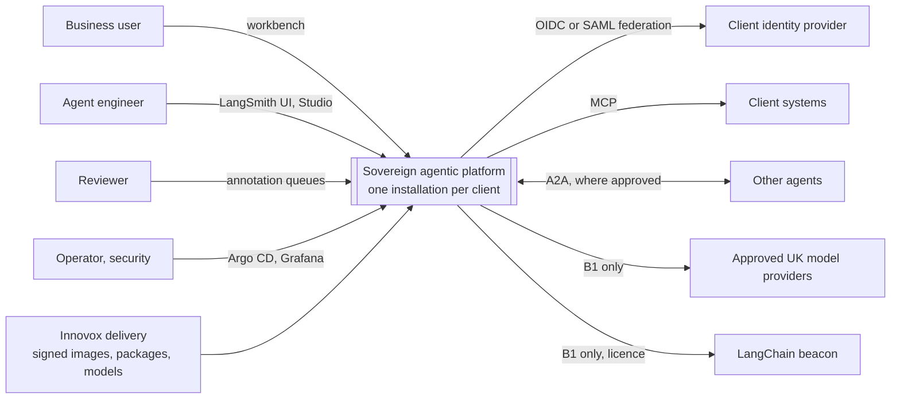
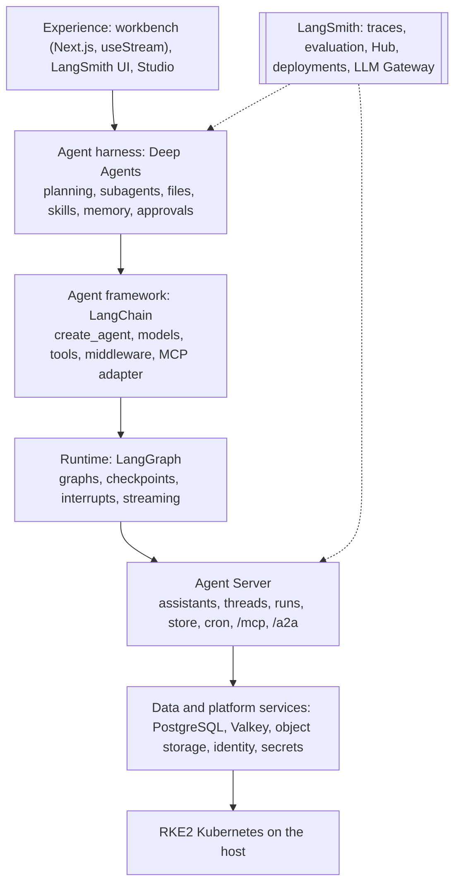
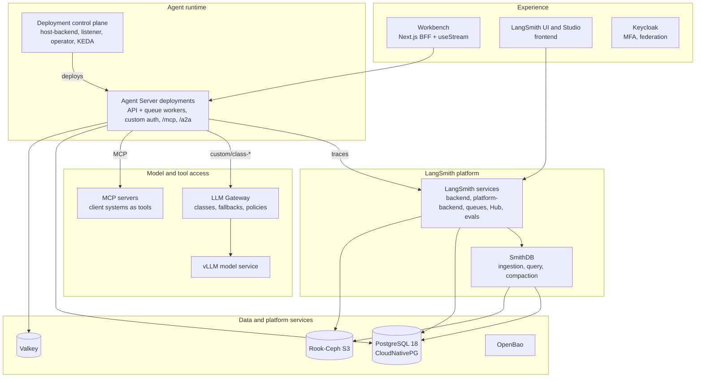
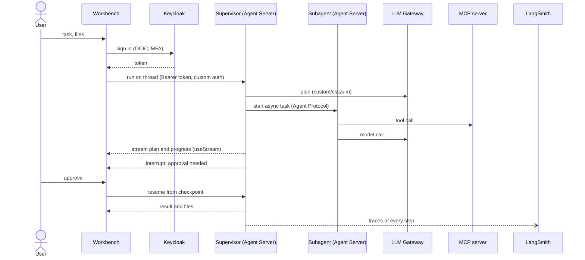
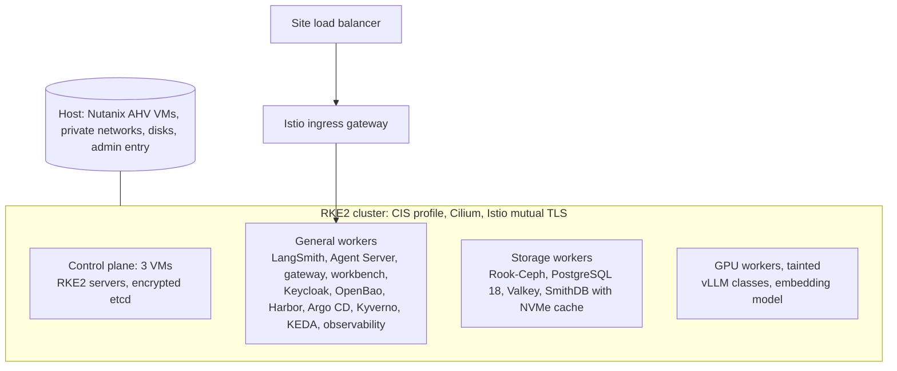

# Solution architecture

This page is the repository view of **DP-AI-001 Sovereign Agentic Platform Solution Architecture v2.0**. The full
document, with narrative for every figure, decisions and risks, is the Innovox design document; the assurance annex
(standards, control catalogue, test strategy) is DP-AI-001-C. Facts about LangChain components come from LangChain's
documentation, cited inline.

## 1. Purpose

The platform lets an organisation run AI agents that carry out long, complex knowledge work (for example a technical
design or a tender response) on infrastructure it controls, with every model, tool and action traced, evaluated and
governed. Innovox installs one platform per client (AD-39), in the client's sovereign data centre or enclave.

| User | Uses | Typical task |
| --- | --- | --- |
| Business user | Workbench | Hand a task to an agent, watch its plan, approve sensitive steps, collect outputs |
| Agent engineer | LangSmith UI, Studio, Git | Build, test, evaluate and release agents; publish prompts and skills |
| Reviewer | LangSmith annotation queues | Score and correct agent outputs to build evaluation datasets |
| Operator, security lead | Argo CD, Grafana, OpenSearch, evidence bucket | Run, upgrade, monitor and assure the platform |

## 2. Rules that shape every choice

1. **Vendor-native first (AD-40, AD-53):** LangSmith, Agent Server, the LLM Gateway and Deep Agents are used as LangChain
   documents them; where LangChain recommends a technology, it is used.
2. **Open source otherwise (AD-52):** only OSI-approved components; LangSmith is the one licensed product.
3. **Infrastructure-only host (AD-43, AD-51):** VMs, private networks, disks, one admin entry point; no managed services.
4. **UK defence assurance:** MOD Secure by Design, NIST SSDF, NCSC CAF, OWASP LLM and Agentic Top 10, CHECK.

## 3. System context (C4 level 1)

## 4. How the LangChain products fit together

LangChain's own summary: Deep Agents is the agent harness, LangChain the agent framework, LangGraph the orchestration
runtime, LangSmith the tracing, evaluation, prompt and deployment platform
([LangGraph overview](https://docs.langchain.com/oss/python/langgraph/overview)).

| Product | Packages | Used for |
| --- | --- | --- |
| Deep Agents | `deepagents` (Python, npm) | Every Innovox agent's harness |
| LangChain | `langchain`, `langchain[mcp]`; `@langchain/mcp-adapters` | Models, tools, middleware, MCP tools |
| LangGraph / Agent Server | `langgraph`; Agent Server image built by `langgraph build` | Durable runtime, approvals, streaming |
| LangSmith | Helm chart `langsmith` 0.17.51 | Tracing, evaluation, Hub, deployments, LLM Gateway |
| Frontend SDK | `@langchain/react` (`useStream`) | Workbench streaming of messages, plans, subagents, interrupts |

Self-hosted deep agents are deployed as LangSmith Deployments described by `langgraph.json`; Managed Deep Agents is a
LangChain cloud service and is not used ([Deep Agents in production](https://docs.langchain.com/oss/python/deepagents/going-to-production)).

## 5. Logical view (C4 level 2)

## 6. Runtime: one workbench task

Other patterns: other agents call platform agents over A2A at `/a2a/{assistant_id}`
([A2A](https://docs.langchain.com/langsmith/server-a2a)); any MCP client can call an assistant as a tool at `/mcp`
([MCP](https://docs.langchain.com/langsmith/server-mcp)); tools act for a user with Agent Auth; cron jobs and run
webhooks handle scheduled work.

## 7. Model routing

Agents name a model class (`custom/class-s|m|l|f`) on the gateway's OpenAI-compatible endpoint
`https://<host>/gateway/v1`, with a workspace-scoped LangSmith service key holding `gateway:invoke`
([gateway authentication](https://docs.langchain.com/langsmith/llm-gateway-authentication)).

| Class | Served by | Mode | Falls back to |
| --- | --- | --- | --- |
| S | vLLM, small | B1, B2 | none |
| M | vLLM, one GPU | B1, B2 | S |
| L | vLLM, multi-GPU | B1, B2 | M |
| F | Approved UK frontier provider | B1 only | L |

Fallbacks never move from a sovereign class to F. Store embeddings call a vLLM embedding model directly; the gateway
serves chat formats only.

## 8. User access

| Interface | Authentication |
| --- | --- |
| Workbench | Next.js server holds the OIDC session (Keycloak, confidential client); forwards the user's token; Agent Server validates it with custom auth |
| LangSmith UI | OIDC SSO, `authType: mixed` with client secret (PKCE deprecated by LangChain) |
| Studio | LangSmith auth; disabled in production with `disable_studio_auth` |
| Operations consoles | Keycloak OIDC, from the jump host only |

Every Agent Server deployment ships custom auth, ownership filters and a store auth handler that scopes memory per
user (AD-57).

## 9. Physical view

B1 and B2 use the same layout; B2 has no egress, an offline licence and software carried in as signed Zarf packages.

## 10. Release lanes

| Lane | Pull request (PR) | Dev (E1) | Test (E2) | Prod (P1) |
| --- | --- | --- | --- | --- |
| Platform | CI checks | Argo CD sync | Upgrade rehearsal | Same tag |
| Agents | Tests, LangSmith evaluations | `langgraph build`, signed image, deploy | Red team | New deployment revision |
| Content | Review | Context Hub dev tag | Test tag | Prod tag |
| Models | Intake check | Serve, evaluate | Risk-owner decision | Gateway configuration |

## 11. Where each item lives in this repository

| Item | Path |
| --- | --- |
| Pinned versions | `versions.yaml` |
| Argo CD applications and mode overlays | `platform/apps`, `platform/overlays/b1`, `platform/overlays/b2` |
| LangSmith configuration | `platform/values/langsmith/` |
| Admission and egress policy | `policies/kyverno/`, `policies/egress/` |
| Nodes and Kubernetes | `infra/opentofu/nutanix/`, `infra/rke2/` |
| Model intake gate | `model-intake/` |
| Red team and E2 tests | `redteam/`, `tests/` |
| Decisions | `docs/adr/` |
| Controls | `docs/controls.yaml` |
