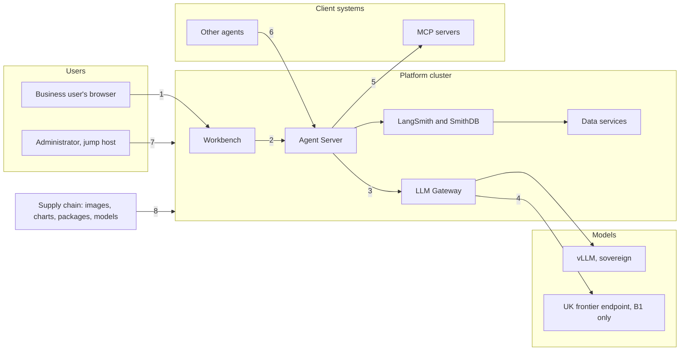

# Threat model

First pass, written before any deployment. It covers the platform as designed in DP-AI-001 v2.0 and as built in
this repository. It is reviewed at each gate and after the penetration test (issue 22). Threats are grouped by
trust boundary; each names the control that answers it (`docs/controls.yaml`, which carries the standard
references) and how far that control is proven today.

## What is being protected

| Asset | Why it matters |
| --- | --- |
| Client data in prompts, files, traces and agent memory | Up to OFFICIAL-SENSITIVE in B1; higher in an enclave, as accredited |
| Model weights and their intake records | A tampered or unapproved model changes every answer |
| Agent definitions, prompts, skills and tools | They decide what an agent can do with a user's authority |
| Credentials and keys (OpenBao, signing keys, gateway keys, user tokens) | Each one is a route past a control |
| The evidence store (audit logs, SBOMs, decision records) | Assurance rests on it being complete and unaltered |
| The software supply chain (images, charts, packages) | The enclave trusts whatever is carried in |

## Trust boundaries

## Threats

Proven means: **CI** a test in this repository fails if the control is removed; **Built** the control is in the
repository but only a deployment can prove it; **Planned** not yet built.

| ID | Boundary | Threat | Answer | Control | Proven |
| --- | --- | --- | --- | --- | --- |
| T-01 | 1 | A user's token is stolen from the browser | The browser never holds a token; the workbench server keeps the session and sends an HttpOnly cookie | CTL-12 | CI (`e2e`) |
| T-02 | 1 | Cross-site request drives the agent with the user's session | Same-origin check and method and path allowlist in the workbench proxy | CTL-07 | CI (`workbench` unit tests) |
| T-03 | 2 | A caller reaches Agent Server without signing in, or through Studio | Custom auth verifies a Keycloak token on every request; Studio access disabled; anything without a rule is refused | CTL-07 | CI (`agent`, `e2e`) |
| T-04 | 2 | One user reads another's threads, runs or memory | Owner-scoped threads and scheduled runs; store namespace forced to the caller | CTL-09 | CI (`agent`, `e2e`) |
| T-05 | 2 | A user changes an agent's definition | Assistants are read-only except for the `agent-admin` role | CTL-07 | CI (`agent`) |
| T-06 | 3 | An agent calls a model that has not been approved, or a provider directly | Agents hold only a gateway key and name a model class; only gateway pods may reach an external model endpoint; Kyverno refuses a model pod with no intake decision. Residual: any pod in the `langsmith` namespace can reach vLLM directly | CTL-04 | CI (policy tests); gateway side Built (issue 12) |
| T-07 | 3 | A model is swapped, back-doored or carries unsafe serialised code | Intake gate: safetensors only, signature check that fails closed, ML-BOM, evaluation thresholds, decision record | CTL-04, CTL-05 | CI (`unit`) with synthetic files; real weights in issue 18 |
| T-08 | 4 | Client data leaves the UK or reaches an unapproved provider | Egress only from the gateway to named UK endpoints (B1); no egress at all (B2); fallbacks never go from sovereign to frontier | CTL-08 | Built (issues 8, 16) |
| T-09 | 3, 5 | Prompt injection in a document or tool result takes over the agent's goal | Approval before any external action; tools on an allowlist; red-team tests | CTL-06, CTL-14 | Approval step CI; red team Planned (issue 22) |
| T-10 | 5 | An MCP server adds or changes a tool to widen what agents can do | Servers come only from deployment configuration; a tool reaches the model only if allowlisted; default is none | CTL-07 | CI (`agent`, `e2e`) |
| T-11 | 5 | An agent acts on a client system beyond the user's own rights | Tools act for the user with Agent Auth; least-privilege service accounts for the rest | CTL-07 | Planned |
| T-12 | 5 | An agent takes an irreversible action nobody approved | `interrupt_on` for every tool with an outside effect; release evaluation `approval_gate` must score 1.0 | CTL-14 | CI (`agent`, `e2e`) |
| T-13 | 2 | Poisoned content written to long-term memory steers later tasks | Memory is per user and per assistant; shared memory is read-only to agents | CTL-15 | Per-user scope CI; shared memory Planned |
| T-14 | 2, 6 | A runaway or looping agent exhausts models or harms other tenants' work | Recursion limits, gateway spend and rate limits, KEDA bounds, run cancellation | CTL-16 | Built (issue 12) |
| T-15 | 6 | Another agent calls a platform agent without authority | A2A and MCP endpoints sit behind the same custom auth; exposure through the mesh is opt-in per agent | CTL-07 | Built (issue 14) |
| T-16 | 7 | An administrator's account is taken over | Keycloak with MFA, administration only from the jump host, no shared accounts, audit of every change | CTL-12, CTL-13 | Built (issue 8) |
| T-17 | 7 | A change bypasses review | All change through Git and Argo CD; branch protection; signed commits and images | CTL-01, CTL-02 | Built; branch protection to be switched on |
| T-18 | 8 | A malicious or altered image runs in the cluster | Registry allowlist, no `latest` tag, Pod Security levels; signature verification at admission for Innovox-built images only, third-party images rely on the allowlist until issue 15 | CTL-01 | CI (`policies`, `helm-render`); LangChain images in issue 15 |
| T-19 | 8 | A vulnerable or malicious package enters an agent image | Pinned dependencies, SBOM and scan on every build, mirrored package index in the enclave | CTL-02, CTL-03 | Scan and SBOM CI (`agent-image`); lockfiles in issue 23 |
| T-20 | 8 | Carry-in media brings tampered software into the enclave | Signed Zarf packages verified before deployment; two-person import | CTL-01 | Built (issue 16) |
| T-21 | P | Traffic inside the cluster is read or altered | Istio mutual TLS in STRICT mode; Cilium default-deny policy | CTL-10 | Built (issues 8, 10) |
| T-22 | P | Data at rest is read from disks or backups | Encrypted volumes and etcd; keys in OpenBao; Object Lock on the evidence bucket | CTL-11 | Built (issues 8, 21) |
| T-23 | P | Logs or evidence are altered to hide an action | Append-only evidence bucket; audit logs shipped off the workload nodes | CTL-13 | Built (issue 20) |
| T-24 | P | A secret is committed to the public repository | No secrets in Git by rule; gitleaks on every pull request; External Secrets from OpenBao | CTL-11 | CI (`secrets`) |
| T-25 | P | Sensitive data is captured in traces | Trace redaction and retention settings in LangSmith; access by workspace role | CTL-09 | Planned (needs a licence) |

## Not yet answered

- T-11 and T-25 have no built control. Both need a licensed LangSmith to design against.
- T-09 can be reduced but not removed. The design assumes an agent can be subverted and limits what a subverted
  agent can do: no credentials, an allowlist of tools, approval before outside effects, no egress.
- Insider threat from a cleared administrator is answered only by separation of duties and audit, which are
  procedures for the operating organisation, not code.
